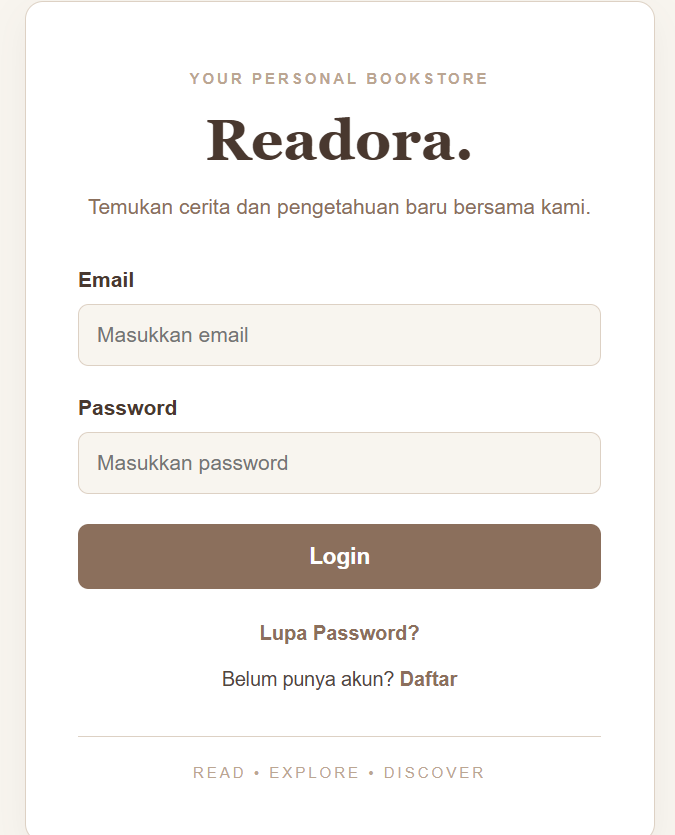
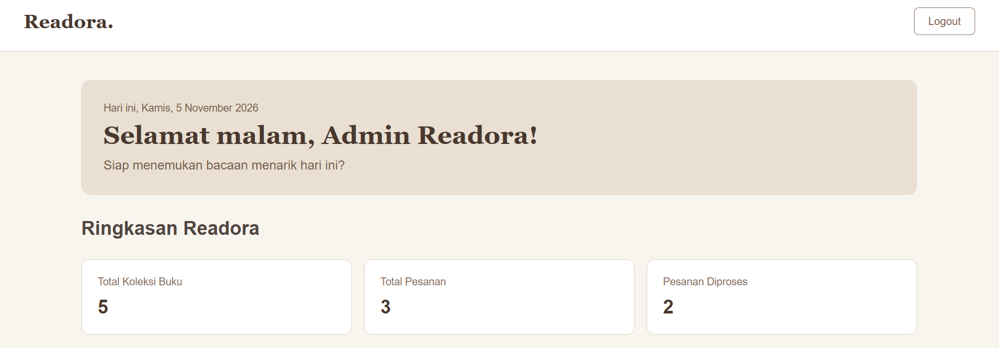
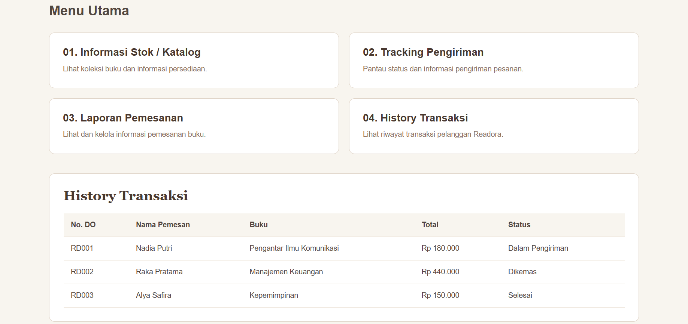
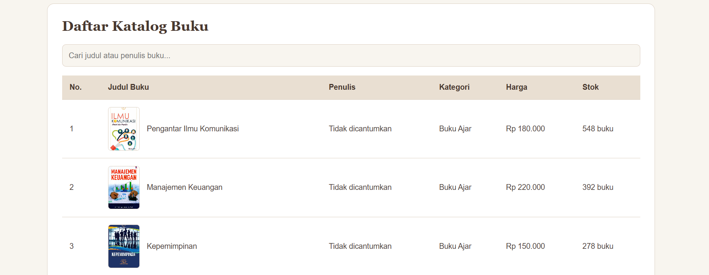
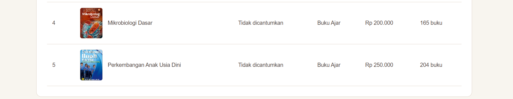
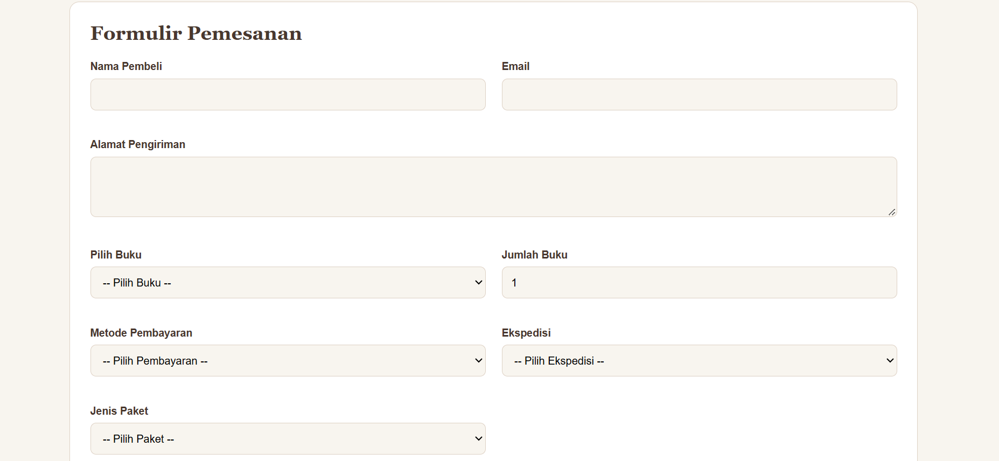
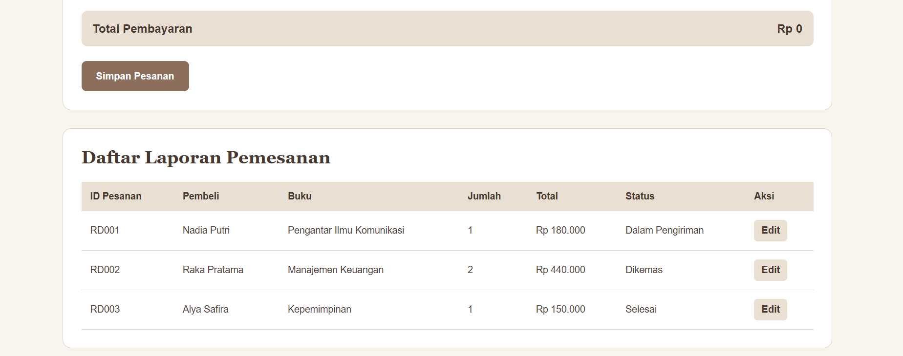
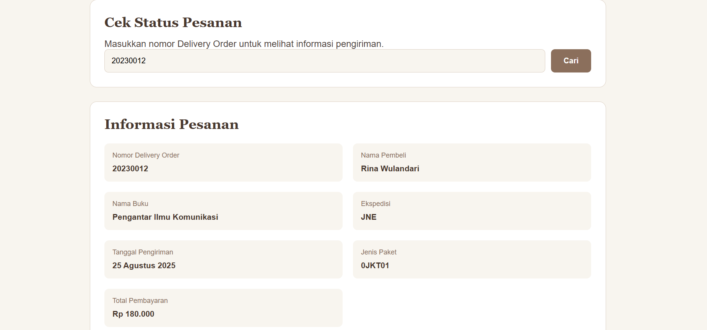
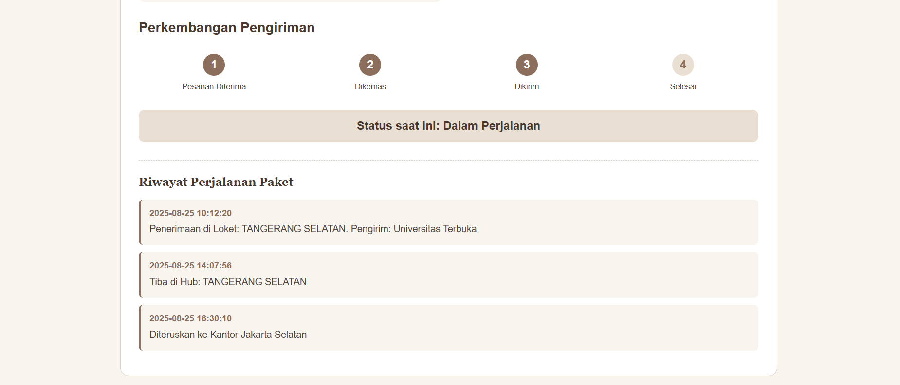
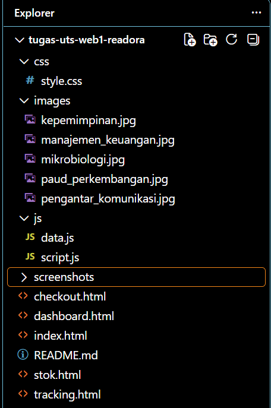

# UTS Pemrograman Web 1: Readora

Repositori ini dibuat untuk memenuhi tugas Ujian Tengah Semester (UTS) mata kuliah Pemrograman Web 1. Aplikasi website toko buku sederhana bernama Readora ini dirancang menggunakan HTML, CSS, dan JavaScript yang menyediakan fitur utama berupa login pengguna, dashboard, informasi stok/katalog buku, checkout, laporan pemesanan, serta tracking pengiriman. Aplikasi ini berjalan secara client-side menggunakan data dummy yang disimpan dalam file JavaScript tanpa database maupun backend.

## Identitas Mahasiswa
* Nama: Berliansa
* NIM: 312510324
* Mata Kuliah: Pemrograman Web 1
* Nama Project: Readora

---

## Teknologi yang Digunakan
* HTML5: Membuat struktur dan elemen halaman website menggunakan elemen HTML yang terstruktur and semantik.
* CSS3: Mengatur tampilan, warna, tata letak, dan desain responsif website.
* JavaScript: Mengatur interaksi pengguna, validasi formulir, manipulasi DOM, pengolahan data, dan fitur website.
* Visual Studio Code: Digunakan sebagai editor untuk menulis dan mengelola kode program.

---

## Struktur Folder Project
Project Readora disusun dengan struktur folder sebagai berikut:

UTS Web 1 Readora/
* 📁 css/
  * 📄 style.css
* 📁 js/
  * 📄 data.js
  * 📄 script.js
* 📁 images/
  * 📷 (gambar sampul buku)
* 📁 screenshots/
  * 📷 (dokumentasi hasil pengerjaan)
* 📄 index.html
* 📄 dashboard.html
* 📄 stok.html
* 📄 checkout.html
* 📄 tracking.html
* 📄 README.md

---

## Langkah-Langkah Pembuatan Project dan Penjelasan

### Tahap 1: Persiapan Struktur Folder dan Project
Membuat folder utama project Readora beserta lima file HTML, folder CSS, folder JavaScript, dan folder images. Struktur ini dibuat agar file program lebih terorganisasi dan mudah dikelola.

### Tahap 2: Pembuatan Halaman Login (index.html)
Membuat halaman login sebagai tampilan awal aplikasi Readora. Halaman ini menyediakan input email dan password, tombol Login, serta fitur Lupa Password dan Daftar menggunakan modal atau pop-up. JavaScript digunakan untuk melakukan validasi akun berdasarkan data pengguna. Jika informasi login sesuai, pengguna diarahkan menuju halaman Dashboard. Jika tidak sesuai, sistem menampilkan pesan kesalahan menggunakan alert.

### Tahap 3: Pembuatan Halaman Dashboard (dashboard.html)
Membuat halaman Dashboard sebagai halaman utama setelah pengguna berhasil login. Dashboard menampilkan sapaan berdasarkan waktu, tanggal, ringkasan jumlah buku, jumlah pesanan, dan pesanan yang sedang diproses. Selain itu, tersedia navigasi menuju halaman Informasi Stok/Katalog, Tracking Pengiriman, Laporan Pemesanan, serta bagian History Transaksi.

### Tahap 4: Pembuatan Halaman Informasi Stok dan Katalog (stok.html)
Membuat halaman katalog untuk menampilkan informasi buku yang tersedia. Data buku diambil dari variabel dataKatalogBuku pada file data.js. Informasi yang ditampilkan mencakup kode barang, nama buku, jenis barang, edisi, stok, harga, dan gambar sampul buku. JavaScript DOM digunakan untuk menampilkan data secara dinamis serta menambahkan data buku baru ke dalam tabel.

### Tahap 5: Pembuatan Halaman Checkout dan Laporan Pemesanan (checkout.html)
Membuat halaman checkout yang menyediakan formulir pemesanan buku. Pengguna dapat mengisi informasi pembeli, memilih buku, menentukan jumlah pesanan, dan memilih metode pembayaran serta jenis pengiriman. JavaScript digunakan untuk menghitung total pembayaran dan mengelola data pesanan. Pada bagian bawah halaman terdapat tabel laporan pemesanan yang menampilkan ID pesanan, nama pembeli, buku, jumlah, total pembayaran, status, dan aksi untuk mengedit pesanan.

### Tahap 6: Pembuatan Halaman Tracking Pengiriman (tracking.html)
Membuat halaman untuk mencari informasi pengiriman berdasarkan nomor Delivery Order (DO). Data tracking diambil dari variabel dataTracking yang terdapat pada file data.js. Setelah nomor DO dimasukkan, JavaScript akan mencari data yang sesuai dan menampilkan informasi penerima, status pengiriman, ekspedisi, tanggal pengiriman, jenis paket, total pembayaran, serta riwayat perjalanan paket. Fitur ini juga dilengkapi dengan tampilan perkembangan atau progress pengiriman.

### Tahap 7: Implementasi dan Pengujian JavaScript DOM
Mengimplementasikan JavaScript untuk mengatur interaksi pada setiap halaman website. Beberapa penerapannya meliputi:
* Validasi email dan password pada halaman login.
* Menampilkan dan menutup modal Lupa Password dan Daftar.
* Menampilkan sapaan berdasarkan waktu pada Dashboard.
* Menampilkan data katalog secara dinamis.
* Menambahkan data buku menggunakan manipulasi DOM.
* Menghitung dan mengelola total pembayaran pada halaman Checkout.
* Menampilkan laporan pemesanan dan riwayat transaksi.
* Mencari data pengiriman serta menampilkan riwayat perjalanan paket.

### Tahap 8: Pengujian dan Penyelesaian Project
Melakukan pengujian terhadap setiap halaman dan fitur untuk memastikan navigasi, tampilan, validasi formulir, serta interaksi JavaScript berjalan sesuai fungsinya. Selain itu, dilakukan pemeriksaan kembali terhadap struktur folder, pemanggilan file CSS dan JavaScript, serta penggunaan data dummy.

---

## Dokumentasi Struktur dan Kode Program
Dokumentasi berikut digunakan untuk memperlihatkan susunan file dan implementasi kode dalam project Readora.

---

## Media dan Tautan Informasi

### Video Penjelasan Project
Video penjelasan berisi pemaparan mengenai sistematika pembuatan aplikasi Readora, alasan pemilihan desain, penggunaan HTML, CSS, dan JavaScript, serta demonstrasi fitur-fitur website.
* Link YouTube: https://youtu.be/1HcTlivsHus?si=yAnGgbWmR_9G2tyj

### Link Repository
* GitHub Repository: https://github.com/berliansa/uts-pemrograman-web1-readora

---

## Kesimpulan
Melalui pengerjaan UTS ini, saya berhasil membuat aplikasi website toko buku sederhana bernama Readora dengan menggunakan HTML, CSS, dan JavaScript. Project ini membantu saya memahami penerapan struktur HTML, pengaturan tampilan menggunakan CSS, serta penggunaan JavaScript untuk validasi formulir, manipulasi DOM, dan pengolahan data secara dinamis. Dengan adanya lima halaman utama, yaitu Login, Dashboard, Informasi Stok/Katalog, Checkout, dan Tracking Pengiriman, aplikasi Readora diharapkan dapat menggambarkan penerapan dasar pengembangan website front-end secara terstruktur dan interaktif.